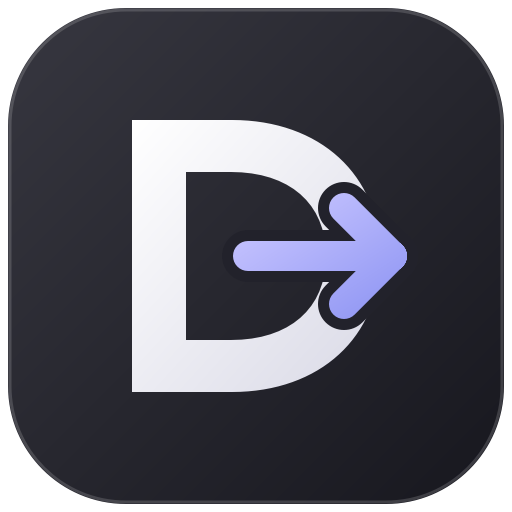
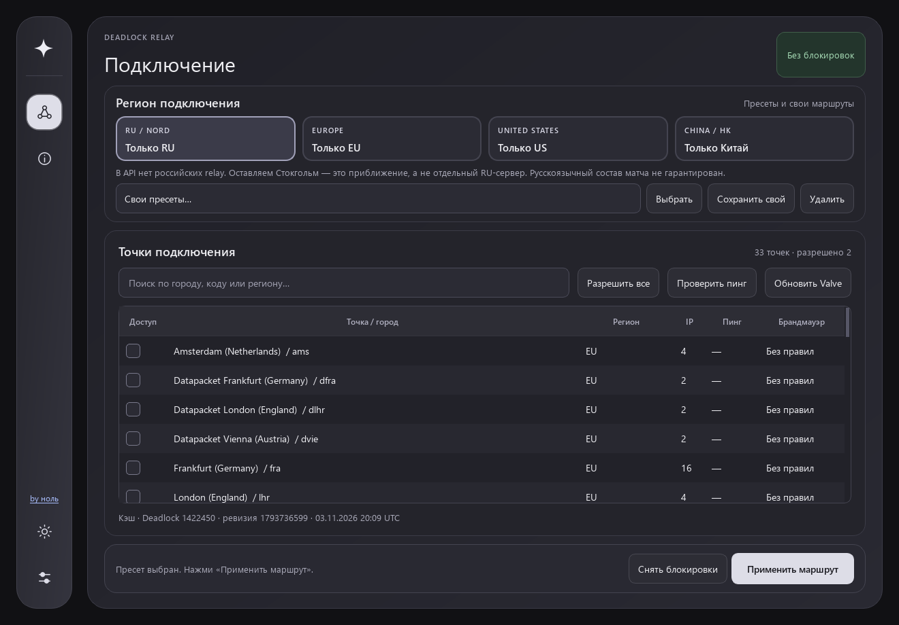
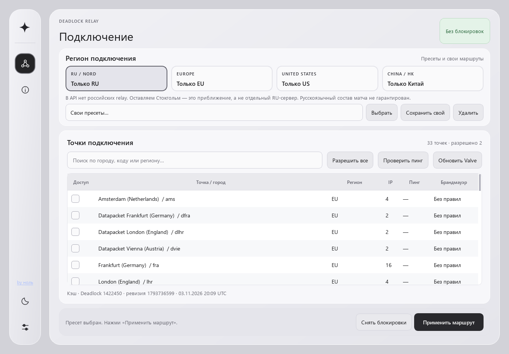
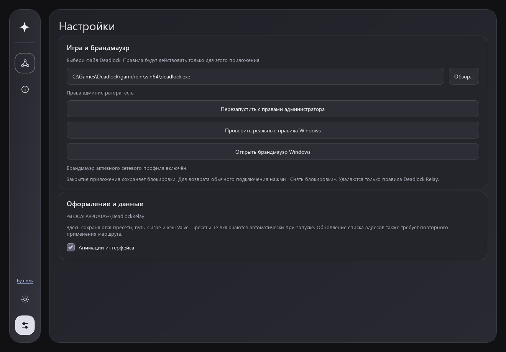
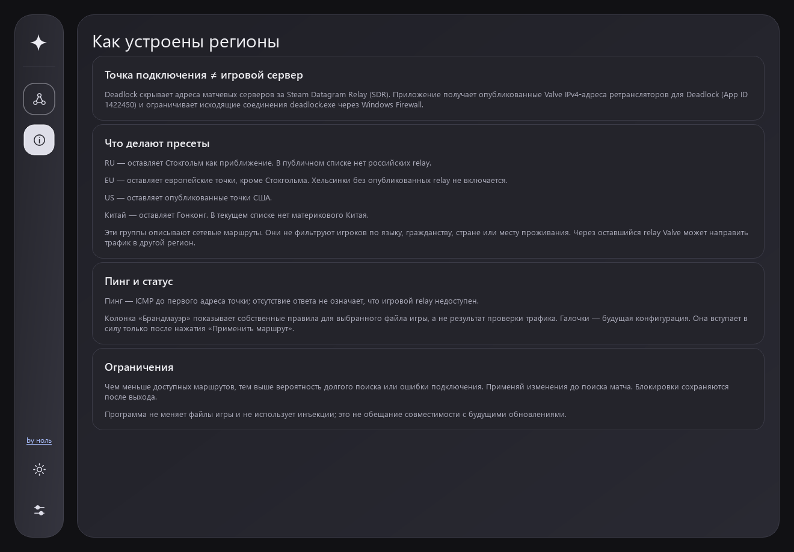

<p align="center"></p>

# Deadlock Relay

<h2 align="center">Сделал <a href="https://www.youtube.com/@zero-r2x1">ноль</a></h2>
<p align="center"><a href="https://www.youtube.com/@zero-r2x1">YouTube-канал автора →</a></p>

**Выбор доступных маршрутов Valve для Deadlock.**

Windows-приложение с русским интерфейсом, светлой и тёмной темами. Выбирайте регион подключения, измеряйте пинг и сохраняйте свои пресеты. Работает через Windows Firewall; не изменяет файлы игры и не использует инъекции.

## Скачать

Откройте [последний релиз](https://github.com/zero-r3x1/deadlock-relay/releases/latest):

- **DeadlockRelay-1.0.0-Setup.exe** — установщик с ярлыками и удалением через настройки Windows.
- **DeadlockRelay-windows-x64.zip** — переносная версия. Распакуйте всю папку и запустите `DeadlockRelay.exe`.

**Windows 10/11 x64. Python для готовой версии не нужен.** Установщик устанавливает приложение для текущего пользователя. Для изменения правил приложение запросит права администратора. Сборки не подписаны цифровым сертификатом.

## Скриншоты

### Тёмная тема



### Светлая тема



### Настройки



### О регионах



## Возможности

- Пресеты RU / EU / US / Китай, ручной выбор точек и свои маршруты.
- Поиск по городу, коду и региону; ICMP-пинг и адреса в подсказках.
- Конфигурация Valve, кэш и встроенный снимок для работы без сети.
- Проверка прав администратора и состояния брандмауэра.
- Переключатель темы в боковой панели, анимации наведения и переходов.
- Сохранение выбранной темы, настроек и пресетов.

## Использование

1. Установите приложение через Setup либо распакуйте ZIP.
2. При необходимости подтвердите перезапуск с правами администратора и включение брандмауэра.
3. В настройках проверьте путь к `deadlock.exe`. Доступны поиск по библиотекам Steam и ручной выбор.
4. Выберите пресет или отметьте точки, которые нужно оставить доступными.
5. **До поиска матча** нажмите «Применить маршрут» и подтвердите изменения.
6. Для возврата обычного подключения нажмите «Снять блокировки».

**Закрытие и удаление приложения не снимают блокировки. Перед удалением нажмите «Снять блокировки».** Удаляются только собственные правила из группы `DeadlockRelay.Managed.v1`, без сброса брандмауэра Windows.

## Что означают регионы

| Пресет | Остающиеся точки | Ограничение |
|---|---|---|
| RU | Стокгольм | Приближение: российских relay в текущем API нет |
| EU | Известные европейские точки, кроме Стокгольма | Не фильтрует игроков по языку |
| US | Опубликованные точки США | Не гарантирует состав матча |
| Китай | Гонконг | Материкового Китая в текущей конфигурации нет |

Пресеты управляют ретрансляторами, а подбором игроков управляет Valve. Через разрешённый relay игра может подключиться к серверу другого региона. Отдельный RU-пул или китайский матчмейкинг не создаётся. Язык, гражданство и место проживания игроков не определяются.

Пинг измеряется до relay, а не до скрытого матчевого сервера. Отсутствие ICMP-ответа не означает недоступность игрового трафика. Возможные IPv6 и непубличные маршруты не контролируются. Обновление конфигурации не меняет правила автоматически: маршрут нужно применить повторно.

## Запуск из исходников

Требуются Windows 10/11 x64 и Python 3.12+.

```powershell
python -m venv .venv
./.venv/Scripts/python.exe -m pip install -r requirements.txt
./.venv/Scripts/python.exe main.py
```

Настройки и кэш находятся в `%LOCALAPPDATA%/DeadlockRelay`.

## Сборка и проверка

```powershell
./build.ps1
# Для Setup установите Inno Setup 6:
./build-setup.ps1 -DistDir dist
```

При нестандартном пути к компилятору передайте `-CompilerPath 'C:/path/to/ISCC.exe'`. Версия задаётся параметром `-Version`. В `dist` появятся переносной ZIP и Setup.exe.

```powershell
./.venv/Scripts/python.exe -m unittest discover -s tests -v
./.venv/Scripts/python.exe main.py --self-check
./.venv/Scripts/python.exe tools/ui_stress.py
./.venv/Scripts/python.exe tools/capture_screenshots.py
```

39 автоматических тестов проверяют планы блокировок, защиту общих IP, повреждённые данные, фоновые задачи, темы и интерфейс. Системные изменения в тестах заменены заглушками. Реальное применение правил, UAC и результат в матче требуют проверки на игровом компьютере. [Подробности](docs/final-verification.md).

## Исходный код

| Путь | Назначение |
|---|---|
| `blocker/core.py` | API Valve, пресеты и планы |
| `blocker/firewall.py` | Windows Firewall через PowerShell |
| `blocker/ui.py` | Интерфейс Qt и фоновые задачи |
| `blocker/motion.py`, `themes.py`, `style.qss` | Анимации и темы |
| `assets` | Иконки и встроенная конфигурация |
| `installer/setup.iss` | Сценарий установщика |
| `tests`, `tools` | Тесты, скриншоты и инструменты сборки |

Python, PySide6 и Qt поставляются с лицензиями авторов: [THIRD_PARTY.md](THIRD_PARTY.md), [licenses](licenses). Динамические Qt DLL можно заменить совместимыми модифицированными библиотеками. VB.NET-код CS2 Server Picker не включён; реализация написана самостоятельно.

Неофициальный проект, не связанный с Valve.
