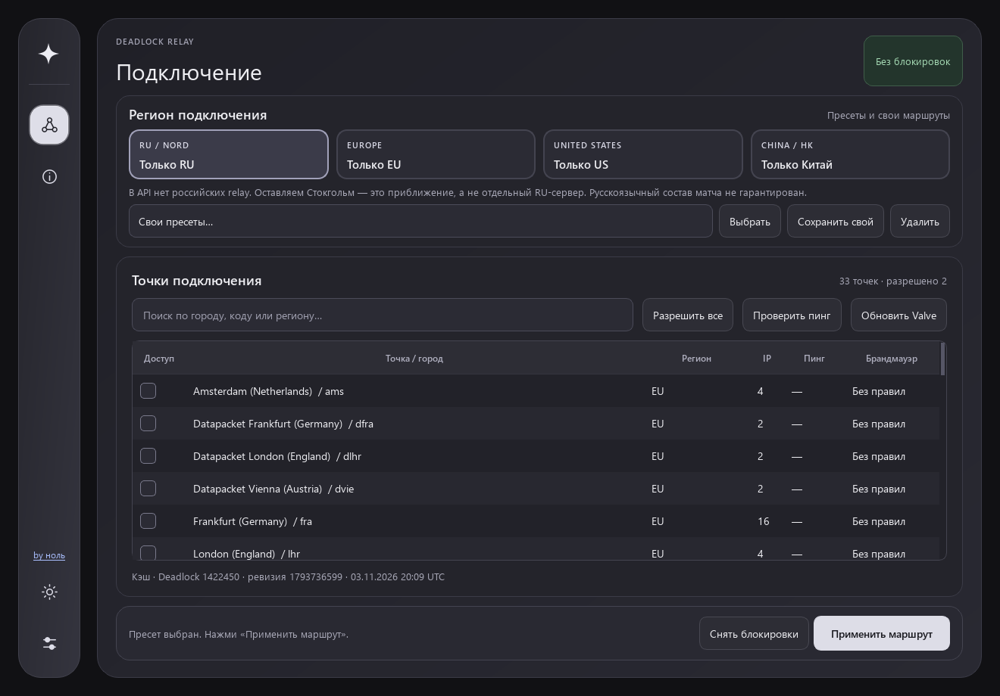
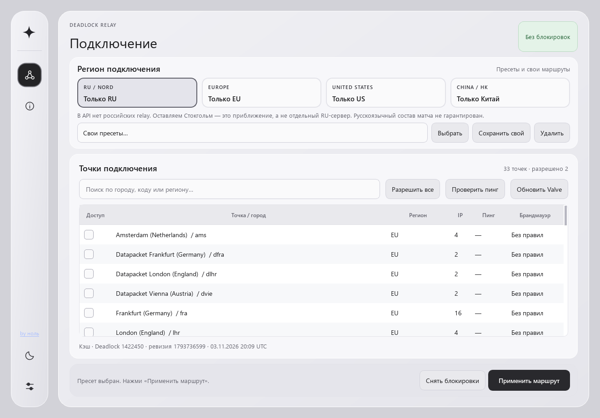

# Deadlock Relay 1.0.0

[YouTube-канал автора →](https://www.youtube.com/@zero-r2x1)

Первая публичная версия приложения для выбора доступных ретрансляторов Valve в Deadlock.

- RU / EU / US / Китай, ручной выбор точек и свои пресеты.
- Поиск, ICMP-пинг и обновление конфигурации Valve.
- Проверки прав администратора и состояния брандмауэра.
- Светлая и тёмная темы, анимации и сохранение настроек.
- Setup.exe и переносной ZIP для Windows 10/11 x64, без установки Python.

## Установка

Скачайте `DeadlockRelay-1.0.0-Setup.exe` и выполните установку. Для переносного запуска распакуйте `DeadlockRelay-windows-x64.zip` целиком. Закройте старое окно перед запуском обновления. Сборки не подписаны цифровым сертификатом.

## Важно

Пресеты ограничивают relay, а не состав игроков. RU использует Стокгольм, Китай — Гонконг. Применяйте маршрут до поиска матча. Закрытие и удаление приложения не снимают блокировки: сначала нажмите «Снять блокировки».

39 автоматических тестов пройдены; проверены API Valve, чтение Windows Firewall, пинг и интерфейс. Реальное применение правил и матчмейкинг не проверялись. Подробности — `docs/final-verification.md`.

## Скриншоты

Остальные скриншоты и инструкции сборки — в [README](https://github.com/zero-r3x1/deadlock-relay#readme).
